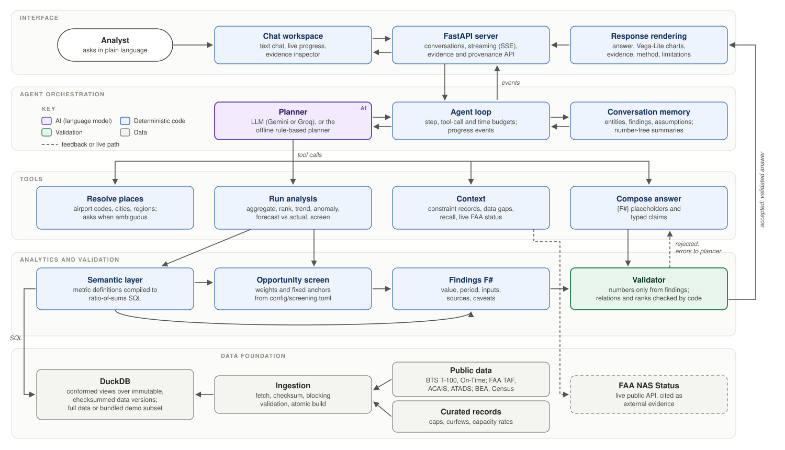

# Architecture

Airport Investment Intelligence answers analyst questions about US airports with numbers computed by deterministic
code from public data. A language model plans the work and explains the result. It never produces a value, a rank or
a score, and code checks its explanation before anyone sees it.

*Editable structure: [docs/diagrams/architecture.mmd](docs/diagrams/architecture.mmd).*

**Execution flow**
1. The analyst types a question in the chat workspace. The FastAPI server streams the turn as server-sent events.
2. The **agent loop** builds the context: the question, a structured memory block from earlier turns and the tool
   schemas. It then asks the **planner** for the next step. The planner is an LLM, or the offline rule-based planner.
3. The planner calls typed **tools**:
   * resolve the airports or the region;
   * run one or more analyses;
   * fetch context such as constraint records or information gaps.

   Every call is validated against a schema and runs under step, tool-call and time budgets.
4. The **deterministic analytics** compile each metric to SQL over DuckDB. They return **findings**: each value with
   its unit, period, inputs, sources and caveats, under a stable id (`F12`).
5. The planner drafts the answer with `compose_answer`. Numbers appear only as placeholders (`{F12}`), and every
   assertion is a typed claim.
6. The **validator** checks the draft.
   * If it is rejected, the errors go back to the planner for another attempt.
   * If it is accepted, the answer is rendered with charts, evidence, assumptions and limitations, and streamed to
     the UI.

## A. Components

| Component | Code | Responsibility |
|---|---|---|
| Chat workspace | `web/` (vanilla ES modules, vendored Vega-Lite) | Streams tool progress and answers; evidence inspector for every number; charts; conversation list |
| API server | `src/airport_app/server.py` (FastAPI, SSE) | Conversations, streaming turns, cancellation, evidence and provenance endpoints, retry de-duplication |
| Agent loop | `src/airport_agent/runtime.py` | Model and tool turns, budgets, pairing of every tool call with a result, context cap, events and traces |
| Planner | `src/airport_agent/models.py`, `offline.py` | One `ModelBackend` interface: Gemini, Groq or the offline rule-based planner |
| Memory | `src/airport_agent/memory.py`, `assumptions.py` | SQLite transcript, persisted findings, structured state, number-free summaries, keyword recall, assumptions that make findings stale |
| Tools | `src/airport_analytics/tools.py` | `resolve_entities`, `describe_catalog`, `run_analysis`, `derive`, `query_sql` (labelled exploratory), `check_information`, `airport_constraints`, `get_finding`, `compose_answer`, plus memory tools and `live_airport_status` |
| Analytics | `src/airport_analytics/` (`semantic.py`, `analysis.py`, `screening.py`, `resolver.py`) | Metric catalog, analysis operators, opportunity screen, place resolution |
| Evidence and validation | `evidence.py`, `claims.py`, `render.py` | Findings, typed-claim checks, rendering |
| Data foundation | `src/airport_data/` | Fetch, checksum, validate and build the DuckDB database, with lineage |

## B. Data architecture

**Sources.** Public datasets are downloaded by script: BTS T-100 and On-Time, FAA TAF, ACAIS and ATADS, BEA income,
Census CBSA delineation, FAA NASR and OurAirports. A hand-curated file of cited constraint records is loaded the
same way. One live public API, FAA NAS Status, provides current delay programs. Its responses are stored as external
evidence and are not part of the database.

**Pipeline:** `fetch → integrity check → immutable raw version (sha256) → blocking validation → atomic DuckDB build`.
* Each source is an adapter that declares its tables and checks, and is registered in one place.
* A file that fails validation is never loaded; the last valid version keeps serving.
* A rebuild from the same archive is bit-for-bit identical.
* Every row carries its source, period and version, so a finding can point to the exact downloaded file.

**Normalization.**
* Airports are keyed on the stable BTS `airport_id`, with crosswalks to FAA, IATA and ICAO codes and to county and
  CBSA.
* Conformed views decode codes and attach Census regions.
* Ratios are always evaluated as ratios of sums at the requested grain, never as averages of ratios.
* Each source keeps its own reporting window. Answers show the window of every value.

**Demo dataset.** `demo/snapshot/` (42 MB of Parquet) is a subset of the same database:
* all reference and annual tables;
* the flight rows that touch New England airports, LAX, SNA, SFO and ANC.

For those airports the values are identical to the full database (tested). Analyses that would need other airports
are refused with an "outside the demo dataset" error, never answered partially.

## C. Scoring methodology: Passenger Growth Opportunity Screen

The screen ranks **passenger growth opportunity**. It does not establish that a terminal is the binding constraint,
and it does not compute returns. The model is versioned in `config/screening.toml`.

| Factor | KPI | Normalization (fixed anchors, clipped) | Weight |
|---|---|---|---|
| Projected passenger increase | FAA TAF enplanements, FY2035 − FY2025 (absolute) | log10: 10k → 0, 10M → 100 | 0.50 |
| Realized growth | BTS T-100 passengers, trailing 12 months vs the prior 12 | linear: −5% → 0, +10% → 100 | 0.30 |
| Market strength | Home-CBSA per-capita income (BEA) | linear: $45k → 0, $110k → 100 | 0.20 |

**Score.** `score = Σ weightᵢ × pointsᵢ`. The score is additive, so each answer shows every factor's contribution as
its own finding.

**Fixed anchors.** Scores do not depend on which airports are in the result set, so they compare across regions and
runs. Identical inputs give identical scores.

**Eligibility.** At least 500k annual enplanements (FAA ACAIS). Smaller airports are listed as below scale.

**Missing data.** An airport missing any input is listed as not scored, with the reason. There is no imputation and
no reweighting. Zero is never used for unknown.

**Ties and robustness.**
* Gaps under 3 points are reported as ties.
* Ranks are recomputed under four weight scenarios: base, equal, demand-only and momentum-heavy.
* Each rank is reported with its range across scenarios.

**Flags.** Flags appear beside the score and never change it.
* **Regulatory caps and curfews** count only with primary or secondary evidence in effect on the as-of date.
  * A conditional record is marked as conditional and never stated as one value. Example: SNA's 2026–2030 passenger
    limit is 12.2 or 12.5 million, depending on 2021–2025 traffic and mitigation.
  * Weaker records are shown as *reported*.
* **Airfield capacity versus schedule** is one-sided. The schedule count is a lower bound (On-Time reporting
  carriers), so the flag can show that the airfield is binding, but never that it has headroom.
* **Carrier concentration** is flagged when one carrier holds more than 50% of seats.

**Restrictions.** A regulatory limit is a legal ceiling. It is not the airport's actual traffic, not its physical
terminal capacity, and not evidence of unmet demand on its own.

**Other KPIs.**
* **Congestion:** departure delay rate, average taxi-out, scheduled peak hour (95th percentile), tower operations
  and NAS delay per arrival. These are airside indicators.
* **Long-haul share:** departures (or passengers) on segments at or above a threshold distance.
  * All flights are reported first, with the passenger and freight splits beside them.
  * The threshold is a parameter, and alternatives are shown when the question leaves it open.
* **Unmet demand:** no public dataset measures denied demand. The answer reports demand-pressure indicators (seat
  factor, share of passengers on capacity-tight routes, peak pressure, delays, forecast versus actual), a labelled
  hypothesis with competing explanations, and the dataset that would be needed.

## D. AI responsibilities

| Task | Done by |
|---|---|
| Understanding the question; choosing airports, metrics, periods and analyses; deciding when to ask | **AI** (LLM planner) or the offline rule-based planner |
| Resolving place names, codes and regions (ambiguity is returned, never guessed) | Deterministic resolver |
| Every calculation, score, rank, comparison direction and chart value | Deterministic engine |
| Writing the explanation, hypotheses and judgments | **AI**, through placeholders and typed claims |
| Deciding whether the evidence supports each kind of claim | Deterministic validator |
| Profitability, ROI, valuation | Not computed. Financial claims are rejected because no economics model exists |

The AI never sees a number it could write into prose: all values reach the answer through `{F#}` placeholders. A
summary of earlier turns contains no numbers by design, so memory can never become a source of values.

## E. Agent orchestration

**Loop.** At most 14 model steps, 30 tool calls and 240 seconds per turn, checked before every call.
* A cancelled or interrupted query still returns a paired result.
* Each request has a hard context cap; old tool results are compacted to finding ids.

**Clarification and assumptions.**
* An ambiguous place ("Portland") produces one focused question.
* A contrast that makes the intent clear ("LA vs Santa Ana") proceeds, and the choice is stated as an assumption.

**Follow-ups.** The memory block carries the entities in focus, the last ranked list, a findings index and the active
assumptions. "The top two of those", "the first airport we discussed" and "use 2000 miles instead" therefore
resolve against the conversation.

**Stale findings.** A changed parameter is recorded as a *bound assumption*. Findings computed under the old value
become stale and can no longer be cited.

**Missing information.** `check_information` classifies a need: exists, derivable, proxy, external, or not
measurable. The answer then runs the labelled proxies and names the next useful dataset, rather than stopping at
"no data".

**Offline planner.** A deterministic, rule-based planner drives the same tools and validator without any model. It
makes the product demonstrable and testable without a key, and it is labelled as such in every answer and in the UI.

## F. Evidence and validation

* **Findings** are the only source of numbers. Each records its execution envelope: operation, full specification,
  resolved airports, catalog version, scoring-config hash and data build. `get_finding(reproduce)` replays it and
  reports whether it matches.
* **Validator rules:**
  * Literal numbers and number words are rejected, as are findings cited next to the wrong airport and stale
    findings.
  * A year may appear only if it is a period of a cited finding.
* **Typed claims:**

| Claim | Requirement |
|---|---|
| `fact` | Cites findings; no comparative, causal or financial language |
| `comparison` | Same metric, unit, class and period; code checks the direction against the values (within 5% means "similar") and writes the sentence |
| `ranking` | Must come from a rank or screen operation; code writes the rank, set size and scenario range |
| `hypothesis` | Required for causes, unmet demand and capacity need; needs indicator findings and competing explanations |
| `assessment` | Criteria must cite findings, and the favoured option must match the values; can abstain |
| `external` | Web pages, official records and live status (W#); numbers only inside a verbatim quote checked against the stored text, with the source link shown |

* **Vocabulary gates** reject certainty, financial and capacity-need language where the evidence cannot support it.
  They are defence in depth; the structural checks above are the guarantee.
* Every answer carries **assumptions, limitations and a method section** generated from configuration, not written
  by the model.

## G. Key trade-offs

* **Deterministic engine vs flexible LLM analysis.**
  * Every number is reproducible and explainable; the cost is maintaining a metric catalog.
  * An AST-whitelisted SQL tool covers the long tail, and its results are labelled exploratory.
* **Custom loop vs agent framework.**
  * The invariants (paired tool results, budgets, validation before display) live in a few hundred lines that are tested
    with scripted models.
  * A framework would have to be worked around to enforce them.
* **Typed claims vs free prose.** Code-written comparisons and ranks cannot get a direction wrong. The prose is less
  fluent.
* **Bulk public files vs live APIs.** Bulk files give reproducibility and lineage. Freshness follows the publishers'
  release schedules, and one live API covers "right now".
* **Lexical memory vs embeddings.** References in this domain are codes, names and ids, where exact matching wins.
  No extra service or cost is needed.
* **Over-invalidation vs silent staleness.** Re-running an analysis is cheap; citing a finding computed under a
  superseded definition is not.

## H. Scope and limitations

* **What the system measures:**
  * passenger growth opportunity;
  * airside congestion indicators;
  * route and stage-length structure;
  * demand-pressure indicators;
  * dated regulatory and capacity records.
* **What it cannot establish:**
  * **Profitability:** no capital cost, revenue or lease data.
  * **Terminal need:** public structured data has no gate or square-footage capacity.
  * **Measured unmet demand:** no spill, booking or fare series.
* **Coverage:**
  * On-Time covers domestic flights of reporting carriers only, and coverage is shown per answer.
  * T-100 passengers are segment enplanements.
  * TAF is an unconstrained FAA forecast.
  * Several curated records are reported rather than verified, and are labelled so.
* **Live AI:** the LLM planners are tested against mocked provider endpoints. Live inference depends on a configured
  provider and key.

## I. Future improvements

* **Terminal suitability (stage B):** dated, primary-source capacity documents (gates, square footage, master plans),
  so the system can say whether a terminal is the binding constraint or whether the airfield or a regulation
  dominates.
* **Project economics (stage C):** a conditional model with analyst-supplied cost, revenue and capacity inputs. Its
  outputs would be labelled as scenario results.
* **Fares:** the BTS DB1B sample, for scarcity signals in unmet-demand questions.
* **Analyst-configurable scoring (not built):**
  * Analysts adjust weights, anchors and thresholds as named scoring profiles, and define new metrics in the
    semantic layer.
  * The AI may search the data for relationships and *propose* a metric or a scoring hypothesis, with its rationale
    and evidence.
  * A proposal never changes a score by itself. It is back-tested, reviewed and approved by an analyst.
  * Only then is it persisted as a deterministic, versioned and tested profile, like `config/screening.toml` with
    its `model_version`. Every score records the profile version it used.

  The boundary stays where it is today: **AI proposes hypotheses; approved deterministic logic produces scores.**
