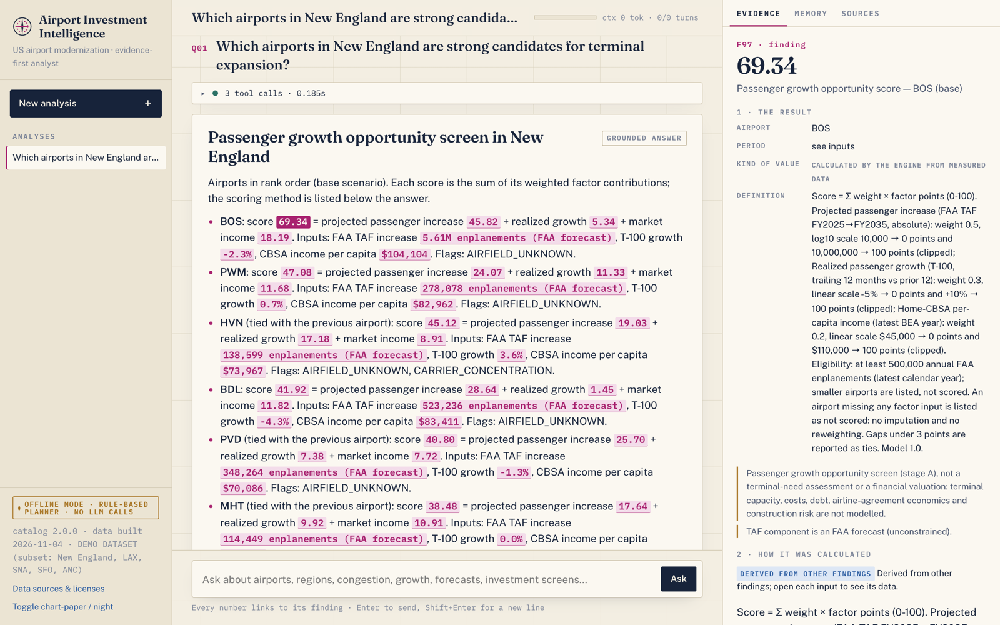
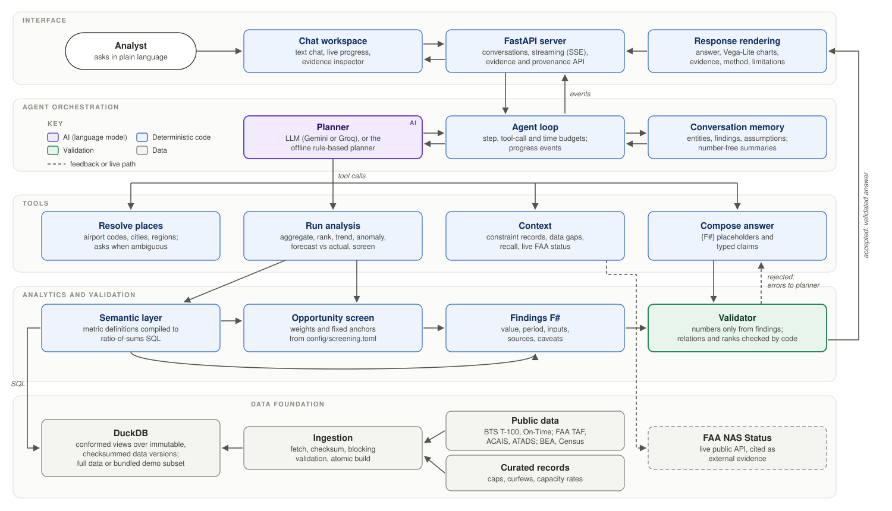

# Airport Investment Intelligence

**A conversational analyst that identifies and evaluates US airport expansion opportunities. It combines public FAA
and BTS aviation data, deterministic analytics and an AI agent that explains every result with its evidence.**

Ask questions such as "Which New England airports are strong candidates for terminal expansion?" or "Compare LA and
Santa Ana congestion" and get a ranked, sourced answer.
* Every number is computed by deterministic code and traceable to the public file it came from.
* The scoring logic is explicit and versioned.
* The AI's explanation is validated before you see it: comparisons, ranks and claims of cause are checked against the
  data.
* Each answer says what it assumes and what the data cannot establish.



<sub>The running application. Each highlighted value opens its evidence: definition, inputs, period and source.
Shown in offline mode on the bundled demo dataset, where a rule-based planner stands in for the LLM.</sub>

## Capabilities

* **Opportunity screening and ranking.** A passenger growth opportunity score for any region or set of airports:
  * forecast demand, realized growth and market income;
  * per-factor contributions, ties, and rank stability across weighting scenarios.
* **Congestion analysis.** Delay rate, taxi-out, scheduled peak hour, tower operations and system delay, compared
  over the same window with code-checked directions.
* **Airport-to-airport comparison** on any catalog metric, with metric, unit and period compatibility enforced.
* **Flight and traffic analysis.** Long-haul share (all flights, passenger and freight), stage length, seat factor,
  carrier concentration, trends, and forecast versus actual.
* **Evidence-backed explanations.** Every value is a finding with its source dataset, period and version.
  Regulatory limits and capacity records are quoted verbatim from their official source, with a link.
* **Conversational follow-ups.** "The top two of those", "use 2000 miles instead", "which one should we prioritize?",
  and corrections such as "I meant Portland, Maine".
* **Assumptions and uncertainty.** Hypotheses come with competing explanations. Proxies are labelled as proxies, and
  the system abstains when evidence is insufficient. It never turns an unknown into zero.

## How it works



1. The **agent loop** gives the planner the question and a structured memory of the conversation. The planner is an
   LLM, or an offline rule-based planner.
2. The planner calls **typed tools**: resolve places, run analyses, fetch constraint records, compose the answer.
3. The **deterministic analytics** compile metric definitions to SQL over a DuckDB database built from public data.
   They return findings with stable ids.
4. The planner writes the answer with placeholders such as `{F12}` instead of numbers, and with typed claims.
5. The **validator** rejects literal numbers, unsupported comparisons, misattributed values and financial claims,
   and sends errors back to the planner. An accepted answer is rendered with charts, evidence and limitations.

| AI (language model) | Deterministic code |
|---|---|
| Understands the question, plans the analyses, asks when a question is ambiguous | Resolves places, computes every value, score, rank and chart |
| Writes the explanation and hypotheses through placeholders | Checks comparisons, ranks and claim types; writes the method section |

Design details and trade-offs are in **[ARCHITECTURE.md](ARCHITECTURE.md)**.

## Scoring methodology

The **Passenger Growth Opportunity Screen** ranks where passenger growth is strongest. It is a screening score, not
an ROI or valuation: capital costs, revenues and lease economics are not in public data.

| Factor | KPI (source) | Normalization | Weight |
|---|---|---|---|
| Projected passenger increase | FAA TAF enplanements, FY2035 − FY2025 | log10, 10k → 0 to 10M → 100 | 50% |
| Realized growth | BTS T-100 passengers, trailing 12 months vs the prior 12 | linear, −5% → 0 to +10% → 100 | 30% |
| Market strength | Home-CBSA per-capita income (BEA) | linear, $45k → 0 to $110k → 100 | 20% |

* **Score** = Σ weight × points.
  * Each contribution is shown and links to its input.
  * Anchors are fixed, so scores compare across regions.
  * Identical inputs give identical scores.
* **Eligibility:** at least 500k annual enplanements.
* **Missing data:** an airport missing any input is listed as not scored, with the reason. There is no imputation.
* **Ties and robustness:** gaps under 3 points are ties. Ranks are recomputed under four weight scenarios.
* **Flags** are shown beside the score and never folded into it:
  * regulatory caps and curfews (conditional limits stay conditional);
  * airfield capacity against the schedule;
  * carrier concentration.
* **Limits of the score:**
  * It measures demand growth, not capacity pressure, so a high score does not show that the terminal is the
    constraint.
  * The absolute forecast increase favours large airports.
  * The weights are analyst assumptions.

**Unmet demand** is never presented as measured. No public dataset records denied demand. Answers report
demand-pressure indicators, a labelled hypothesis with competing explanations, and the data that would settle it.

## Data and evidence

| Source | Provides |
|---|---|
| [BTS T-100 Segment](https://www.transtats.bts.gov/Tables.asp?QO_VQ=EEE) | Passengers, seats, freight and distance by route, for US and foreign carriers |
| [BTS Airline On-Time Performance](https://www.transtats.bts.gov/Tables.asp?QO_VQ=EFD) | Flight-level delays, taxi times and schedules (domestic, reporting carriers) |
| [FAA Terminal Area Forecast](https://www.faa.gov/data_research/aviation/taf) | Forecast enplanements and operations |
| [FAA passenger boardings (ACAIS)](https://www.faa.gov/airports/planning_capacity/passenger_allcargo_stats/passenger) | Annual enplanements |
| [FAA ATADS](https://www.aspm.faa.gov/opsnet/sys/airport.asp) | Tower operations |
| [BEA](https://apps.bea.gov/regional/downloadzip.htm) and [Census CBSA](https://www.census.gov/geographies/reference-files/time-series/demo/metro-micro/delineation-files.html) | Market income and metro-area definitions |
| [FAA NAS Status](https://nasstatus.faa.gov/api/airport-status-information) | Live delay programs (public API) |
| Curated records | Passenger caps, curfews, runway geometry and FAA capacity profiles, each with a source URL, verbatim quote and evidence level (e.g. the [SNA settlement agreement](https://www.ocair.com/about/administration/settlement-agreement/key-provisions-settlement-agreement/)) |

* Source files are archived as immutable, checksummed versions and validated before loading.
* Each value in an answer shows its period and coverage, and links to the dataset page and the original file.
* Records with weak evidence are labelled *reported* and are never treated as fact.
* Data terms and third-party licenses: [NOTICE.md](NOTICE.md).

## Example questions

| Question | The answer includes |
|---|---|
| Which airports in New England are strong candidates for terminal expansion? | Ranked growth screen with score breakdowns, flags, ties and scenario ranks |
| Compare LA and Santa Ana airport congestion levels. | Same-window airside indicators; SNA's official passenger and departure limits, quoted with their conditions |
| What is the percentage of long-haul flights out of Anchorage airport? | All flights, then the passenger and freight splits. Anchorage is a major cargo hub, so they differ several-fold |
| What is the unmet flight demand in SFO airport and why? | Demand-pressure indicators, a hypothesis with alternatives, and SFO's runway and FAA capacity records |

Verified follow-ups:
* *Compare congestion at the top two of those* (after the New England screen)
* *Which one should we prioritize?*
* *Use 2000 miles instead* (after the Anchorage question)
* *How busy is Portland?*, which asks PDX or PWM, then *Actually I meant Portland, Maine*

## Quick start

**Requirements:** macOS or Linux, Python 3.12 or newer.

### Demo (no API key, no data download)

```bash
git clone https://github.com/maskilx/airport-investment-intelligence.git
cd airport-investment-intelligence
./scripts/demo.sh
```

Open **http://127.0.0.1:8765**. The first run took 14 seconds from a clean clone (no pip cache), and it is near-instant after that.
* The script creates a virtual environment, installs the app and loads the bundled demo dataset (`demo/snapshot`).
* The dataset is a 42 MB subset of the real data: New England airports, LAX, SNA, SFO and ANC.
* For those airports, values match the full database. Other airports are reported as outside the demo dataset.
* The demo runs the offline rule-based planner, labelled in the UI. No model calls are made.

### Full data

```bash
./scripts/bootstrap.sh      # environment, public data download (~500 MB) and database build
./scripts/start.sh          # http://127.0.0.1:8765
```

The first download takes about an hour (measured end to end from a clean clone), mostly for the monthly BTS
exports. If the download is interrupted, running the script again repeats it (unchanged files are de-duplicated).

### Live AI

```bash
./scripts/configure-gemini-key.sh   # stores the key securely (Keychain on macOS)
./scripts/mode.sh gemini
./scripts/start.sh --restart
```

Providers, request budgets and data operations: **[docs/configuration.md](docs/configuration.md)**.

## Validation and limitations

**Tests.** `.venv/bin/python -m pytest` runs the offline suite; no test calls a model provider.
* **Deterministic analytics:** golden values, score additivity and reproducibility, the four questions above and
  their follow-ups, the demo dataset against the full database, and a bit-for-bit rebuild.
* **Agent behaviour:** scripted model responses cover tool calls, rejected answers and recovery, budgets,
  cancellation, memory and stale findings, and the streaming API.
* **Provider adapters:** tested against mocked HTTP endpoints.

**Limitations.**
* Live LLM planning depends on a configured provider. Its quality is not covered by the offline suite.
* Profitability and terminal need are not established. They need capital-cost, revenue and terminal-capacity data
  that public sources do not provide.
* Unmet demand is inferred from indicators. On-Time covers domestic flights of reporting carriers only, and coverage
  is shown in each answer.

## Repository layout

```
src/airport_data/       ingestion: fetch, validate, build DuckDB (one adapter per source)
src/airport_analytics/  metric catalog, analysis operators, screening, findings, validator, tools
src/airport_agent/      agent loop, planners, memory, charts, live FAA status
src/airport_app/        FastAPI server (streaming)
web/                    chat workspace
config/                 scoring model, ingest plan, information gaps, coverage rules
data/curated/           cited constraint records
demo/snapshot/          demo dataset (Parquet subset of the real data)
docs/                   configuration, architecture diagram (diagrams/, images/), validation queries
tests/                  offline test suite
```
